# Campus Incidents

A Flutter app for reporting campus issues: broken facilities, water shortages, power outages, damaged furniture, sanitation problems and safety concerns. Students submit reports with an optional photo and follow them until they're resolved. Authorised staff review the reports and update their status.

| Login | Home | Report form | Reports |
|---|---|---|---|
| 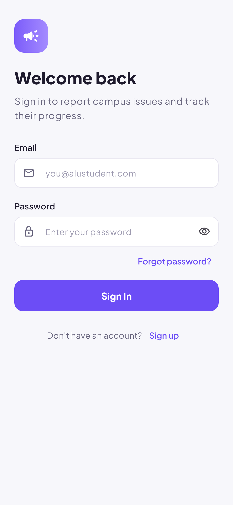 | 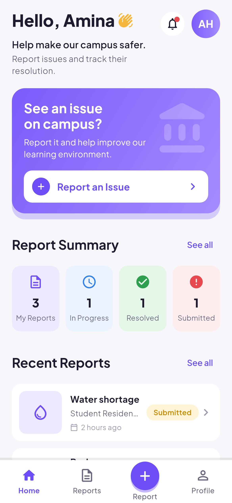 | 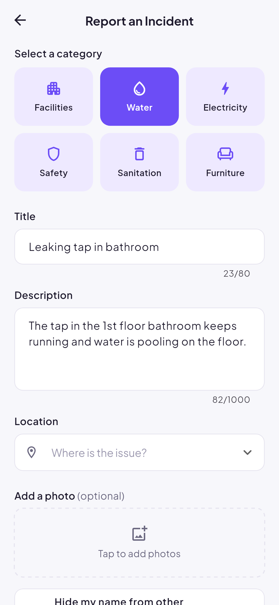 | 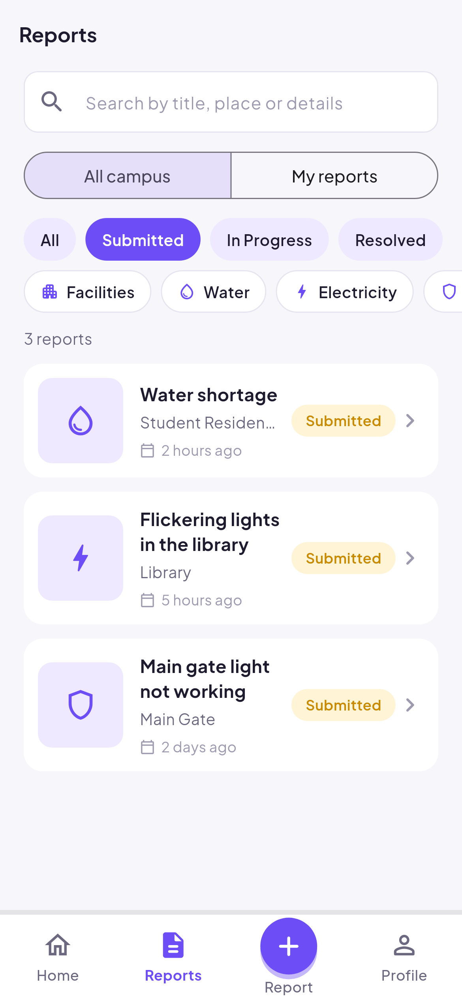 |

| Details | Profile | Staff home | Staff update |
|---|---|---|---|
| 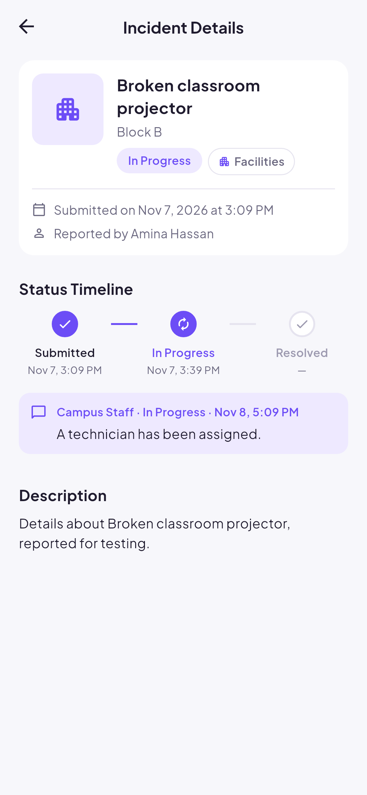 | 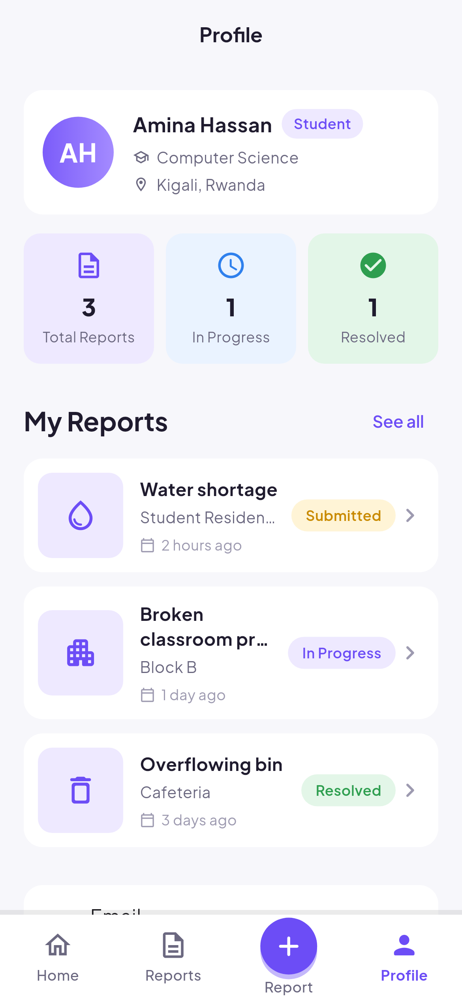 |  | 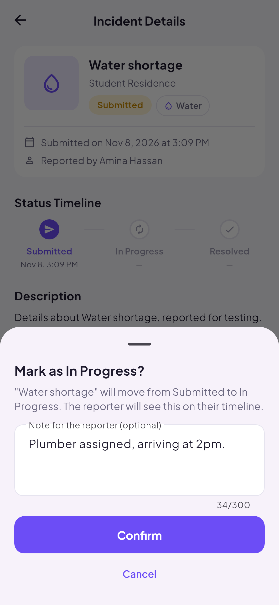 |

| Updates | Verify email | Anonymous option | Staff view of an anonymous report |
|---|---|---|---|
| 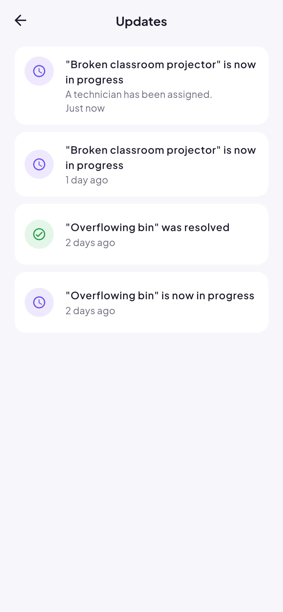 | 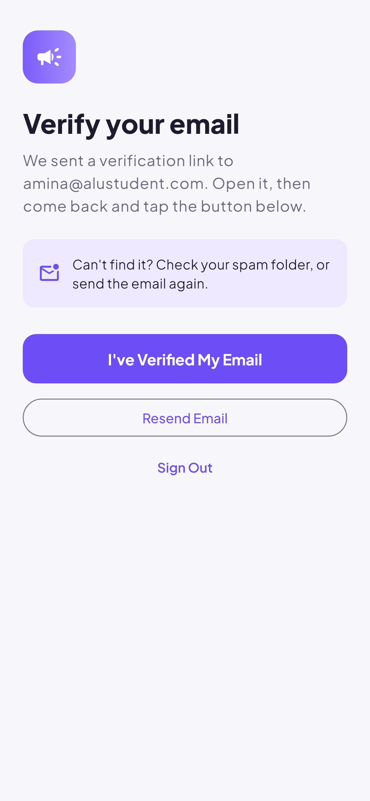 | 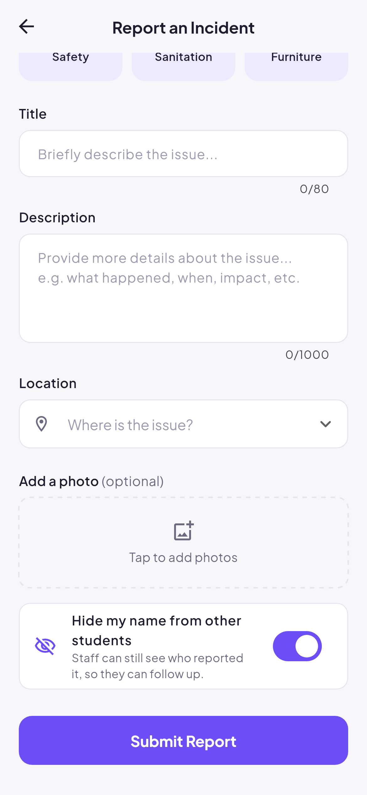 | 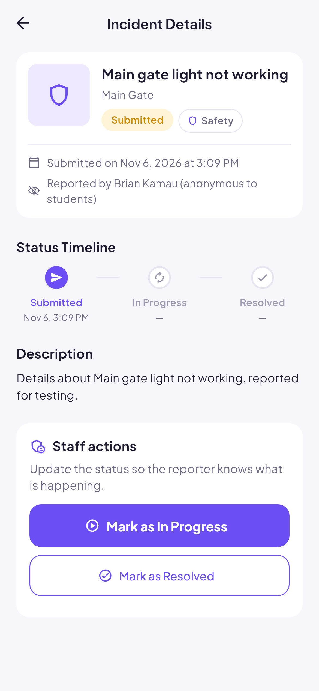 |

## Features

**Students**
- Sign up with an ALU email (`@alustudent.com` or `@alueducation.com`), verify it from the link sent by email, sign in, reset a forgotten password
- Report an issue: category, title, description, campus location and an optional photo from the camera or gallery
- Browse every report on campus, search it, and filter by status, category or "my reports"
- Follow each report on a status timeline (Submitted → In Progress → Resolved), with notes from staff
- See updates to their reports in the Updates feed (bell icon on Home)
- Withdraw a report while it's still Submitted
- Hide their name from other students on a report (staff can still see who filed it)

**Staff**
- Campus-wide summary and a shortcut to every report still waiting for review
- Move a report to In Progress or Resolved, with an optional note for the reporter

## Tech stack

| Concern | Choice |
|---|---|
| UI | Flutter (Material 3), bundled Plus Jakarta Sans font |
| State management | Riverpod |
| Navigation | go_router |
| Authentication | Firebase Authentication (email and password) |
| Database | Cloud Firestore |
| Photo storage | Supabase Storage (see below) |

### Why Supabase for photos

Firebase Storage now requires the paid Blaze plan for new projects. With the facilitator's agreement, photos are stored in a Supabase Storage bucket on Supabase's free plan instead. Supabase is configured to trust Firebase ID tokens (third-party auth), so users still sign in only once. The storage policies in [`supabase/storage.sql`](supabase/storage.sql) only accept images from a valid Firebase user of this project, and only into that user's own folder.

More detail, with diagrams, is in [docs/ARCHITECTURE.md](docs/ARCHITECTURE.md).

## Project structure

```
lib/
  core/        configuration, theme, router, providers, utilities
  data/        models and repositories (Firebase and Supabase access)
  features/    one folder per feature: auth, home, incidents, report,
               staff, notifications, profile, shell
  shared/      reusable widgets
supabase/      storage bucket and access policies
test/          unit and widget tests
test_rules/    Firestore security-rule tests (emulator)
tool/          admin scripts: demo data, staff role, screenshots
docs/          architecture, demo script, report outline, screenshots
```

## Running the app

```bash
flutter pub get
flutter run
```

The Firebase configuration (`lib/firebase_options.dart`, `android/app/google-services.json`) and the Supabase publishable key are client-side values. They're meant to be shipped in the app and are protected by the Firestore security rules and the Supabase storage policies.

### Demo accounts

Load the demo data with `tool/seed_demo.mjs` (see below). All demo accounts use the password `Campus2026`.

| Role | Email |
|---|---|
| Student | `demo.amina@alustudent.com` |
| Student | `demo.brian@alustudent.com` |
| Staff | `demo.grace@alueducation.com` |

## Admin tools

The scripts in `tool/` need a Firebase service-account key. Never commit it.

```bash
cd tool && npm install
export GOOGLE_APPLICATION_CREDENTIALS=/path/to/service-account.json

node seed_demo.mjs                        # create demo accounts and reports
node seed_demo.mjs --clear                # remove the demo reports
node make_staff.mjs someone@example.com   # grant the staff role
node make_staff.mjs someone@example.com --revoke
```

Everyone who signs up in the app is a student. The Firestore rules stop users from changing their own role, so staff can only be created with `make_staff.mjs`. A staff member still needs a verified ALU email address: the rules and storage policies admit only verified `@alustudent.com` and `@alueducation.com` accounts.

After changing `supabase/storage.sql`, run it in the Supabase SQL editor.

Deploy the Firestore rules and indexes:

```bash
firebase deploy --only firestore:rules,firestore:indexes
```

## Tests

```bash
flutter analyze
flutter test                           # unit and widget tests
cd test_rules && npm install && npm test   # Firestore security rules (needs Java)
flutter test tool/screenshots --update-goldens   # regenerate docs/screenshots
```

## Documentation

- [Architecture, data model, roles and testing](docs/ARCHITECTURE.md)
- [Demo video script](docs/DEMO_SCRIPT.md)
- [Technical report outline](docs/REPORT_OUTLINE.md)
