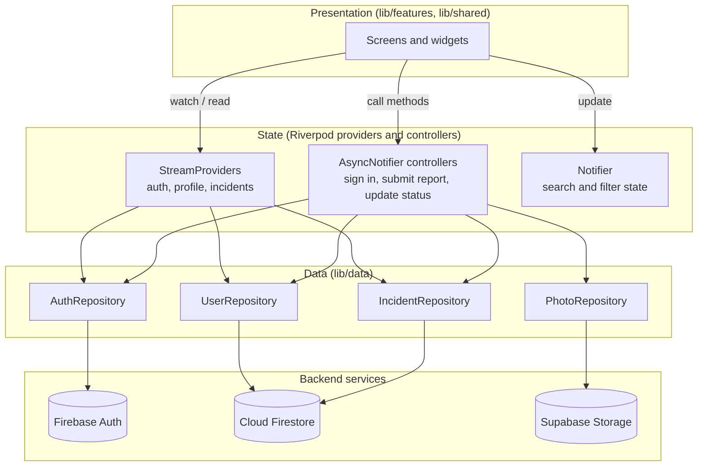
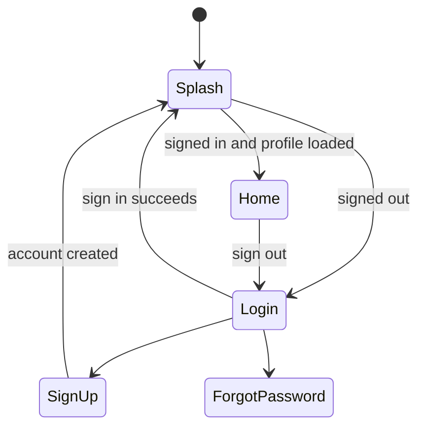
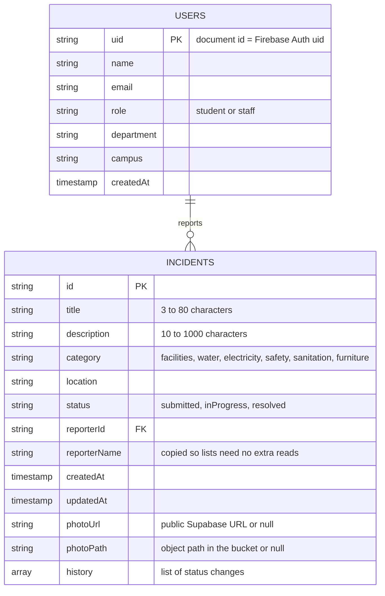
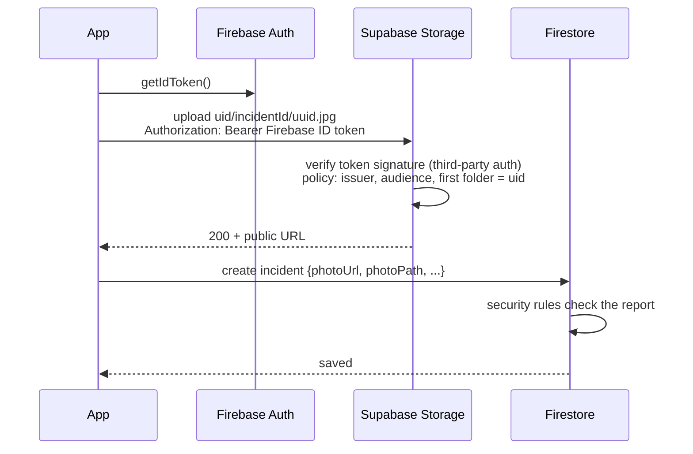

# Architecture

This document explains how the Campus Incidents app is put together. The diagrams use Mermaid, which GitHub renders directly.

## 1. Layers

The app is split into four layers. Each layer only talks to the one below it, so screens never call Firebase or Supabase directly.



| Layer | Folder | Responsibility |
|---|---|---|
| Presentation | `lib/features/*`, `lib/shared/widgets` | Layout, forms, validation messages, navigation |
| State | `*_providers.dart`, `*_controller.dart` | Exposes live data as `AsyncValue`, runs user actions, holds filter state |
| Data | `lib/data/models`, `lib/data/repositories` | Converts Firestore documents to Dart objects, wraps backend calls, maps errors to friendly messages |
| Backend | Firebase, Supabase | Authentication, persistent storage, photo files, access control |

## 2. State management with Riverpod

Riverpod was chosen over Provider, BLoC and Cubit for four reasons:

1. **Live Firestore data fits naturally.** A `StreamProvider` turns a Firestore `snapshots()` stream into an `AsyncValue` with loading, data and error states, which the UI renders with `.when(...)`.
2. **Dependencies are explicit and swappable.** Repositories are providers too, so a test can override `firestoreProvider` with `FakeFirebaseFirestore` and `firebaseAuthProvider` with `MockFirebaseAuth`, and the whole app runs without a network.
3. **Providers compose.** For example, `filteredIncidentsProvider` combines the live incident list, the current filter and the signed-in user, and recomputes only when one of them changes.
4. **No `BuildContext` needed** to read state, so the router's redirect logic can read the auth state directly.

| Provider | Type | Purpose |
|---|---|---|
| `authStateProvider` | `StreamProvider<User?>` | Firebase sign-in state |
| `currentUserProvider` | `StreamProvider<AppUser?>` | Profile and role of the signed-in user |
| `allIncidentsProvider` | `StreamProvider<List<Incident>>` | Every report, newest first |
| `myIncidentsProvider` | `StreamProvider<List<Incident>>` | The signed-in user's reports |
| `incidentProvider(id)` | `StreamProvider.family` | One report, live |
| `incidentFilterProvider` | `NotifierProvider` | Search text, status, category, "mine only" |
| `filteredIncidentsProvider` | `Provider` | Reports after the filter is applied |
| `authControllerProvider` | `AsyncNotifierProvider` | Sign in, sign up, password reset |
| `submitReportControllerProvider` | `AsyncNotifierProvider` | Photo upload and report creation |
| `updateStatusControllerProvider` | `AsyncNotifierProvider` | Staff status changes |
| `activityProvider` | `Provider` | Feed of updates on the user's reports |

## 3. Navigation

`go_router` defines every route. A single `redirect` function decides where the user may go, based on the auth state and profile:



The main tabs (Home, Reports, Profile) live in a `StatefulShellRoute`, so each tab keeps its scroll position. The report form, incident details and activity feed open on top of the tabs.

## 4. Firebase data structure



Each entry in `history` is `{status, changedAt, changedBy, changedByName, note}`. Embedding the history in the incident document means the details screen needs one read, and a status change is a single atomic update (`status`, `updatedAt` and `arrayUnion` on `history`).

`reporterName` is denormalised on purpose. Students can't read other users' profiles, so storing the name on the report avoids an extra read and a looser rule.

**Indexes:** `incidents (reporterId ASC, createdAt DESC)` for "my reports". Listing all reports by `createdAt` uses Firestore's automatic single-field index.

**Search and filtering** happen on the device, over the live list. At campus scale (hundreds to low thousands of reports) this is instant and gives free-text search across title, description and location, which Firestore queries can't do natively.

## 5. Photo storage

Firebase Storage needs the paid Blaze plan for new projects, so photos are stored in **Supabase Storage** on Supabase's free plan, as agreed with the facilitator.



- Supabase is set up to trust Firebase ID tokens, so there's only one login.
- The policies in `supabase/storage.sql` allow an upload only when the token was issued for this Firebase project and the first folder in the path is the user's own uid.
- The bucket accepts only images under 5 MB, and the app resizes photos to 1600 px at 75% quality before uploading.
- If saving the report fails after the photo was uploaded, the app deletes the photo again.

## 6. User roles and access control

| Action | Student | Staff | Enforced by |
|---|---|---|---|
| Sign up | yes (always as student) | via admin script | Firestore rule on `users` create |
| Submit a report | yes | yes | Firestore rule: `reporterId == auth.uid`, real profile name, status `submitted`, server timestamps, photo from own folder |
| Browse and search all reports | yes | yes | Firestore rule: signed in |
| Change a report's status | no | yes, forward only | Firestore rule: `isStaff()`, status rank increases, earlier history unchanged, exactly one new entry signed with the staff member's own name and the current time |
| Edit a report's text | no | no | Firestore rule: only `status`, `updatedAt`, `history` may change |
| Withdraw a report | own, while `submitted` | no | Firestore rule on delete |
| Read a profile | own | any | Firestore rule on `users` read |
| Make someone staff | no | no | Only `tool/make_staff.mjs` with admin credentials |

The UI hides actions a user can't take, but the security rules are what actually enforce them. A modified app, or someone calling the Firestore API directly, still can't break these rules.

The rules also protect data quality, so one bad write can't break the app for everyone:
- `createdAt` and `updatedAt` must equal the server's time (`request.time`), so reports can't be backdated or carry a malformed date.
- History entries may only contain the five known fields, must be dated within an hour of server time, and must name the person making the change.
- On top of that, the Dart models read every field defensively, so even a malformed document (for example one written by an admin script) is shown with defaults instead of crashing the list.

## 7. Testing strategy

| Level | Tool | What it covers |
|---|---|---|
| Unit | `flutter_test` | Models (serialisation, defaults, malformed documents), validators, redirect logic, filters, time formatting |
| Repository | `fake_cloud_firestore`, `firebase_auth_mocks` | Queries, ordering, status updates, error mapping, sign-up and profile-repair racing each other |
| Widget and flow | `flutter_test` with provider overrides | Login, sign up, sign out, report form validation and submission, failed upload, search and filters, details, withdrawing, staff status updates |
| Security rules | `@firebase/rules-unit-testing` on the Firestore emulator | Every allow and deny path in `firestore.rules`, including backdating, fake reporter names, reused photos and rewritten history (27 tests) |
| Live smoke test | Firebase JS SDK against the real project | Deployed rules accept the app's writes and reject role escalation, backdating and impersonation |
| Code review | Independent review pass | Found the unvalidated timestamps and the sign-up race, both fixed with tests |
| Storage policies | REST calls with a real Firebase token | Upload to own folder works; other folders and signed-out uploads are rejected |

Run everything:

```bash
flutter analyze
flutter test
cd test_rules && npm install && npm test
```
